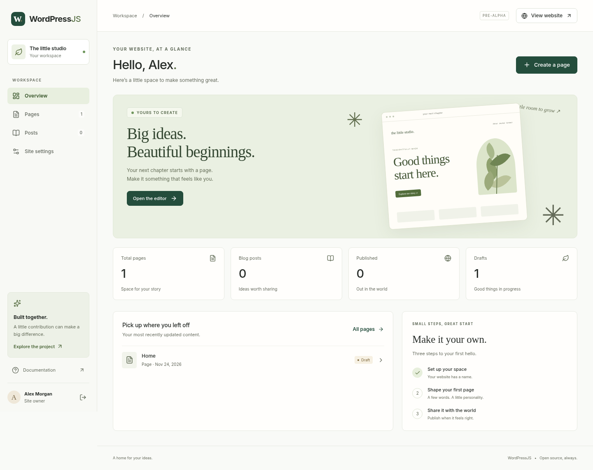

# WordPressJS

An open-source, self-hosted JavaScript website builder for small businesses and independent publishers. Build visually, publish quickly, and own your content.

**Status: 0.1.0-alpha.1 — early, working foundation.** Create a site, edit pages visually, save drafts, and publish a server-rendered website. This is not yet a production-ready replacement for WordPress.



## Get started

Requires **Node 24.x** and npm. No separate database server is needed.

```sh
git clone https://github.com/Ali-Amir-code/wordpress.js.git
cd wordpress.js
nvm use # if you use nvm; otherwise install Node 24 first
npm ci
npm run dev
```

Open **http://localhost:5173/admin/**. On first start, copy the installation key from `data/setup-token.txt` into the setup form and create your own owner account. Edit the starter homepage and click **Publish**. Your public site is at **http://localhost:3000/**.

Content is stored in `data/wordpressjs.sqlite` and survives restarts. Setup has no default password. See [configuration, backups and troubleshooting](docs/OPERATIONS.md).

## What works today

| Area                   | Implemented                                                                                                 |
| ---------------------- | ----------------------------------------------------------------------------------------------------------- |
| Setup and access       | Installation key, one owner, password login, expiring sessions and logout                                   |
| Content                | Pages and posts, search, publication filters, paginated admin lists, unique slugs                           |
| Visual editor          | Puck drag-and-drop, undo/redo, viewport previews, eight validated blocks                                    |
| Media                  | Image uploads, optimization, searchable library, alt text/captions, editor picker and safe deletion         |
| Navigation             | Ordered header/footer links, homepage selection, private previews and automatic redirects on slug changes   |
| Publishing             | Save draft, private saved preview, publish/unpublish, separate public snapshots, stale-write protection     |
| Version history        | Retained page/post versions, comparison, private previews, safe restoration and historical image protection |
| Public website         | Shared block rendering, homepage, pages, journal index and posts; no frontend JavaScript required           |
| Site identity and SEO  | Name, description, language, three palettes, canonical/Open Graph tags, sitemap and robots                  |
| Contributor foundation | Typed workspaces, integration tests, browser tests, CI, dependency updates, architecture and agent guides   |

Built-in blocks: **Hero, Text, Features, Library image, Image URL, Call to action, Quote, Spacer**. The editor includes a small business starter layout. Text sections support headings, bold, italic, underline, links and lists through **Edit text**. Other block fields remain plain text. Forms, custom themes, multiple users and plugins are future milestones. See the [text formatting guide](docs/RICH-TEXT.md).

Open **Media** to upload a JPEG, PNG or WebP, then add a **Library image** block in the editor. Images stay private until published content uses them. [Media guide](docs/MEDIA.md) explains image details, limits and deletion.

Open **Navigation** to choose a homepage, arrange menu links and edit the footer. Save a private draft, preview it, then publish the settings together. Page links follow published address changes. See the [navigation guide](docs/NAVIGATION.md).

Select **Version history** in the editor to compare or preview earlier saved work and restore it as a private draft. Your live page changes only after you publish. See the [version history guide](docs/REVISIONS.md) for retention and image protection.

## Development checks

```sh
npm run check                 # formatting, types, integration tests, production build
npx playwright install chromium
npm run test:e2e              # publishing, media, navigation, version history and rich text
```

`npm run format` formats the project. `npm run build && npm start` runs the built application at **http://localhost:3000/admin/**; if you created `.env`, set `ADMIN_ORIGIN` to that origin for this mode. [Operations guide](docs/OPERATIONS.md) explains the two development ports and production HTTPS requirements.

## Codebase

```text
apps/admin       React workspace and visual editor
apps/server      Fastify API, authentication, SQLite, public HTML
packages/core    Content contracts, validation and starter documents
packages/blocks  Shared rendering and Puck configuration
tests            API/security regression tests and browser journey
docs             Research, architecture, roadmap and handoff
```

## Direction

- A visual website editor, with pages and blog posts in one place.
- A usable default website, with server-rendered HTML and sensible SEO defaults.
- Portable, versioned content; no mandatory hosted service.
- A modular TypeScript codebase that people and AI coding assistants can contribute to.
- MIT licensed. No WordPress source code is included.

## Project guide

- [Product vision](docs/PRODUCT.md)
- [Research and technology choices](docs/RESEARCH.md)
- [Architecture](docs/ARCHITECTURE.md)
- [Roadmap and acceptance criteria](docs/ROADMAP.md)
- [Implementation handoff and next tasks](docs/HANDOFF.md)
- [API guide](docs/API.md)
- [Using the media library](docs/MEDIA.md)
- [Navigation and homepages](docs/NAVIGATION.md)
- [Version history and restoration](docs/REVISIONS.md)
- [Formatting text](docs/RICH-TEXT.md)
- [Running and configuring the app](docs/OPERATIONS.md)
- [Contributing](CONTRIBUTING.md)
- [Instructions for coding agents](AGENTS.md)
- [Security policy](SECURITY.md)

## Project name

WordPressJS is a working title for an independent project, not an official WordPress product. The [WordPress Foundation trademark policy](https://wordpressfoundation.org/trademark-policy/) requires permission to use WordPress in a project name. Naming clearance or a distinct final name is an unresolved release prerequisite. No official WordPress logo is used.

## License

[MIT](LICENSE), copyright WordPressJS contributors.
