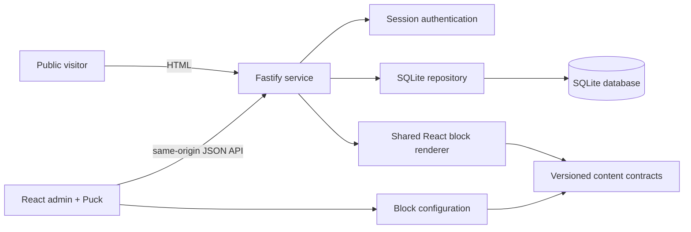

# Architecture

## Modular monolith

The initial application runs on Node 24. npm workspaces organize TypeScript code. React and Puck power the admin; Fastify handles the API and serves server-rendered public pages. SQLite stores users, sessions, site settings and versioned content.

## Boundaries

| Directory | Responsibility |
| --- | --- |
| `packages/core` | Schema version, block validation, content/settings types, starter documents |
| `packages/blocks` | Reusable components, editor field definitions, public rendering |
| `apps/server` | HTTP routes, authentication, persistence, publication and metadata |
| `apps/admin` | Setup, login, overview, pages/posts, editor and site settings |
| `tests` | API integration and real-browser publishing journeys |

The server never trusts editor data. The contract allowlists block types, fields, lengths and URL schemes. Content is text and structured props, not executable HTML. React escapes text during rendering. Unknown schema versions are rejected, not silently coerced.

## Content and publication

Each document has a stable UUID, kind (`page` or `post`), working title/slug/description/blocks, revision counter, timestamps and an optional **published snapshot**. Draft updates increment the revision. Publishing copies the whole draft, including its slug and metadata, into the public snapshot atomically. Public queries read only snapshots. Unpublishing removes the snapshot without discarding the draft.

Updates and publication actions carry the expected revision. Stale writers receive HTTP 409, preventing one browser tab from silently overwriting another. The first version does not retain historical revisions; a revision counter is not a revision-history feature. Slugs are validated and unique within each kind; published slugs are also unique. Pages use `/:slug` (`home` maps to `/`); posts use `/blog/:slug`. System routes are reserved. Changing a published slug removes the old URL on republish; redirects are later work.

## Authentication and trust

An explicit installation token protects first-owner creation. The installer closes after the first user. Password hashing uses Node's async scrypt. Random session tokens are stored only as hashes, expire, and are revoked on logout. Cookies are HttpOnly, SameSite=Strict and Secure on HTTPS. Mutations require the configured Origin and JSON content type. Admin routes require a valid session; no client-side role check is treated as authorization. Authentication endpoints are rate limited.

One owner and one site are supported initially. Role management, invitations, MFA and password recovery are not yet implemented. Future plugin code is trusted code until an actual isolation model exists. There is no plugin upload/install API.

## Persistence and runtime

SQLite uses foreign keys, WAL, prepared statements and numbered migrations. Each state transition is a database transaction or a single conditional statement. Keep the database on local persistent storage. Start with one service process; no horizontal-scaling claim. The synchronous repository keeps operations short; large datasets, search indexing and multi-tenant workloads require additional design. A PostgreSQL adapter must preserve publication and concurrency tests.

Development: Vite proxies `/api` to Fastify, and the public website is served by Fastify. Production: one Fastify process serves the built admin and public HTML. The public website needs no hydration JavaScript for the built-in blocks. Configure a canonical origin rather than trusting arbitrary Host headers.

## Extension contracts

To add a built-in block: add its strict schema in core, shared render component and Puck field configuration in blocks, then validation/rendering coverage. Breaking content changes require a schema migration. This is an internal development seam, not a stable third-party plugin SDK. Themes, custom content types, hooks and a permissioned plugin SDK need separate ADRs.

## Release gates

Public deployment requires naming resolution, security review, backups with restore testing, operational documentation, dependency review and broader accessibility testing. See the roadmap for acceptance criteria rather than inferring readiness from working local features.
