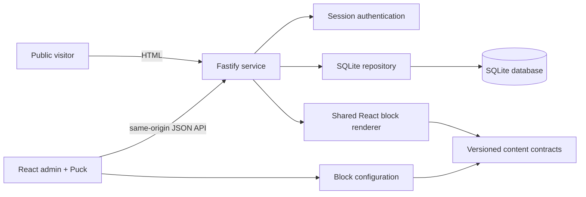

# Architecture

## Modular monolith

The initial application runs on Node 24. npm workspaces organize TypeScript code. React and Puck power the admin; Fastify handles the API and serves server-rendered public pages. SQLite stores users, sessions, site settings and versioned content.

## Boundaries

| Directory         | Responsibility                                                                   |
| ----------------- | -------------------------------------------------------------------------------- |
| `packages/core`   | Schema version, block validation, content/settings types, starter documents      |
| `packages/blocks` | Reusable components, editor field definitions, public rendering                  |
| `apps/server`     | HTTP routes, authentication, persistence, publication and metadata               |
| `apps/admin`      | Setup, login, overview, pages/posts, editor, media, navigation and site settings |
| `tests`           | API integration and real-browser publishing journeys                             |

The server never trusts editor data. The contract allowlists block types, fields, lengths and URL schemes. Content is text and structured props, not executable HTML. React escapes text during rendering. Unknown schema versions are rejected, not silently coerced.

Text sections accept legacy strings or a versioned, bounded rich-text JSON tree. Core validates node/mark types, attributes, links, aggregate characters and list depth before persistence. Shared blocks map these nodes to fixed React elements; public rendering does not import Tiptap or parse HTML. The lazy admin text dialog uses the Tiptap packages already present through Puck, with a matching extension allowlist, local history, plain-text-only clipboard handling and a transaction validation filter. Apply text updates Puck; draft save and publication remain separate. See [ADR 0005](decisions/0005-constrained-rich-text.md).

## Content and publication

Each document has a stable UUID, kind (`page` or `post`), working title/slug/description/blocks, revision counter, timestamps and an optional **published snapshot**. Draft updates increment the revision. Publishing copies the whole draft, including its slug and metadata, into the public snapshot atomically. Public queries read only snapshots. Unpublishing removes the snapshot without discarding the draft.

Updates, restoration and publication actions carry the expected revision. Stale writers receive HTTP 409, preventing one browser tab from silently overwriting another. Slugs are validated and unique within each kind; published slugs are also unique. Pages use `/:slug`, with the selected homepage at `/`; posts use `/blog/:slug`. System routes are reserved.

`RevisionRepository` records immutable saved snapshots in the content transaction and retains the latest 30 versions per entry plus an older current publication. History IDs are separate from content concurrency counters. Restoring validates the snapshot and managed media, replaces only the working draft, and records a new version atomically; public snapshots and routing remain unchanged until publication. Retained versions hold their own media references, released when history expires. Migration 4 preserves existing tables and captures draft/publication upgrade baselines. See [ADR 0004](decisions/0004-content-revisions.md).

The editor lazy-loads a history dialog with metadata/block-change comparison, private previews and explicit restoration. Unsaved edits block restoration; successful restoration resets external fields and remounts Puck from the restored document. This also resets Puck's undo stack, avoiding old internal editor state overwriting recovered content. History is bounded recovery, not autosave or complete backup tooling.

Content schema 1 remains readable and restorable with plain Text strings. Schema 2 also permits rich text. Existing documents upgrade only when an applied text edit needs the new format; opening a document does not create unsaved changes. Database migration 5 changes only the capability marker so older binaries reject databases that may contain rich text. It preserves all existing rows and snapshots byte for byte.

## Navigation and routing

`NavigationRepository` owns independent draft/public menu snapshots, ordered content-ID or URL links, footer text and a homepage selection. Automatic mode retains the original six-page-plus-Journal menu. Explicit homepage selection overrides the legacy `home` slug rule. The same path resolver supplies public links, canonical metadata, sitemap entries and admin live links. Navigation publishes atomically with revision checks and validates that active destinations are published.

Content publication records former natural paths against stable content IDs inside the same transaction. Historical addresses resolve directly to the current canonical path (308); a selected homepage's natural slug temporarily redirects to `/` (302). Current published addresses win over history, unpublished targets yield 404, and redirects use no-store to avoid stale destinations when paths are reclaimed. Migration 3 preserves existing sites and starts with automatic navigation. See [ADR 0003](decisions/0003-navigation-and-routing.md).

The admin lazy-loads the navigation feature and shares a native dialog component with the media library. Private preview renders the saved navigation draft and published page content. Public menus are semantic lists with labeled navigation landmarks and current-page indicators; they require no browser JavaScript.

## Authentication and trust

An explicit installation token protects first-owner creation. The installer closes after the first user. Password hashing uses Node's async scrypt. Random session tokens are stored only as hashes, expire, and are revoked on logout. Cookies are HttpOnly, SameSite=Strict and Secure on HTTPS. Mutations require the configured Origin and JSON content type, except the authenticated multipart image upload. Admin routes require a valid session; no client-side role check is treated as authorization. Authentication endpoints are rate limited.

One owner and one site are supported initially. Role management, invitations, MFA and password recovery are not yet implemented. Future plugin code is trusted code until an actual isolation model exists. There is no plugin upload/install API.

## Persistence and runtime

SQLite uses foreign keys, WAL, prepared statements and numbered migrations. Each state transition is a database transaction or a single conditional statement. Keep the database on local persistent storage. Start with one service process; no horizontal-scaling claim. The synchronous repository keeps operations short; large datasets, search indexing and multi-tenant workloads require additional design. A PostgreSQL adapter must preserve publication and concurrency tests.

Development: Vite proxies `/api` to Fastify, and the public website is served by Fastify. Production: one Fastify process serves the built admin and public HTML. The public website needs no hydration JavaScript for the built-in blocks. Configure a canonical origin rather than trusting arbitrary Host headers.

Media uses an authenticated multipart endpoint and a local storage adapter. Images are decoded into bounded WebP files, with a catalog and draft/published/retained-version references updated inside content transactions. Anonymous media reads require a current published reference; metadata in each block is a snapshot. Pending writes/deletions are recovered on startup. Vite also proxies `/media/`. See [ADR 0002](decisions/0002-media-library.md) and the backup requirements in OPERATIONS.md.

## Extension contracts

To add a built-in block: add its strict schema in core, shared render component and Puck field configuration in blocks, then validation/rendering coverage. Breaking content changes require a schema migration. This is an internal development seam, not a stable third-party plugin SDK. Themes, custom content types, hooks and a permissioned plugin SDK need separate ADRs.

## Release gates

Public deployment requires naming resolution, security review, backups with restore testing, operational documentation, dependency review and broader accessibility testing. See the roadmap for acceptance criteria rather than inferring readiness from working local features.
