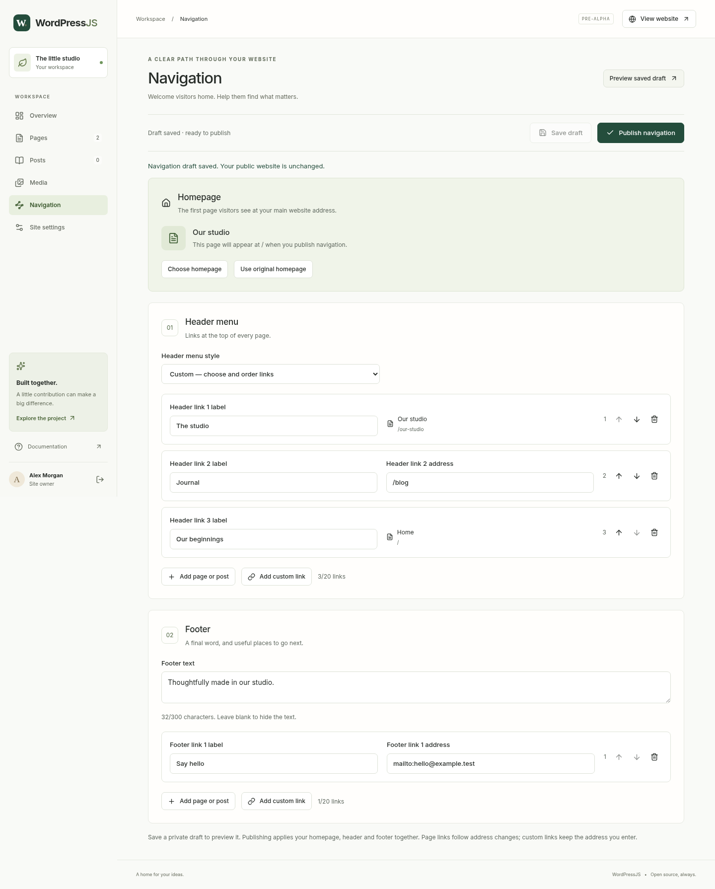

# Navigation and homepages

Open **Navigation** in the workspace to choose a homepage and edit the header and footer. These settings have their own private draft and public version, separate from your page content.

## Choose a homepage

1. Publish the page you want to use.
2. Choose **Navigation → Choose homepage**, search for the page and select it.
3. Save and preview your changes, then choose **Publish navigation**.

The selected page appears at your website's main address, `/`. The former homepage remains available at its normal page address. **Use original homepage** restores the original rule: the published page whose address is `home` appears at `/`.

Changing your selection does not change either page's content or slug. The selected homepage's normal address temporarily redirects to `/`. To unpublish an explicitly selected homepage, first publish a different homepage choice in Navigation. Returning to the original rule also allows unpublishing the `home` page, which restores the coming-soon screen.

## Arrange the header

**Automatic** shows up to six recently published pages and the Journal. Choose **Custom** for a menu you control.

- **Add page or post** selects existing content. Change its label to the wording visitors should see. The link follows the content's current published address, even after a rename.
- **Add custom link** accepts an address such as `/blog`, `https://example.com`, `#contact`, `mailto:hello@example.com` or `tel:+15555550100`. These addresses stay exactly as entered and do not follow page renames. An anchor only works on pages containing that anchor.
- Use the up/down buttons to change the order. They work with the keyboard and announce the new position. Use the remove button to remove a link from your draft.

Each menu allows 20 links, with labels up to 80 characters. Menus are flat; nested dropdowns are not yet supported. Switching back to Automatic keeps your custom links for later use.

## Edit the footer

Footer links use the same controls as header links. Add up to 300 characters of plain footer text, or leave the field blank to hide that text. The site name and copyright line remain visible.

## Save, preview and publish

**Save draft** keeps changes private. **Preview saved draft** opens an authenticated preview of the saved header, footer and homepage choice using the homepage's **published page content**. Unsaved menu edits and unpublished page-content edits are not included. Visitors cannot access this preview.

**Publish navigation** saves any current changes, then publishes the homepage, header and footer together. Pages/posts in an active menu must already be published. You may prepare menu links to drafts, but publication will explain which content needs publishing first. If a linked page is later unpublished, its menu entry disappears until the page is republished.

Page titles and menu labels are independent. Renaming a page does not rewrite your chosen menu label. Unpublishing a page does not remove a manually entered custom URL link.

If another window saved navigation first, the workspace keeps your local input and reports a conflict. Copy any edits you need, then use **Reload saved navigation**. Discarding unsaved work requires confirmation. Leaving the screen or signing out also checks for unsaved changes.

## Page address changes

When you republish a changed page or post slug, its previous address redirects directly to the current address. Repeated changes do not create a chain. The public menu, canonical metadata and sitemap follow the current published address.

An active page takes precedence over historical redirects: publishing different content at a former address reclaims it. Unpublished targets return 404. The root `/` always represents the current homepage choice and never becomes a historical redirect. Query parameters are not copied to redirect destinations.

Redirect history starts when this module is installed; it cannot reconstruct earlier renames. It records changes between published snapshots. If content is unpublished before its slug changes, the removed publication snapshot is not retained as a new redirect source. There is no manual redirect editor yet.

Developers: see [API.md](API.md), [ADR 0003](decisions/0003-navigation-and-routing.md) and `tests/navigation.test.ts`. Operators: back up the entire stopped data directory before the migration described in [OPERATIONS.md](OPERATIONS.md).
